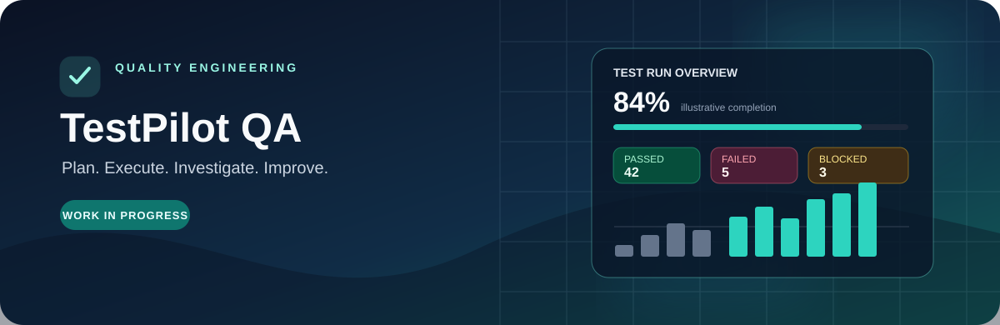

<div align="center">



### A focused workspace for manual QA workflows

Organize test cases, execute test runs, connect failures to defects, and review quality signals in one place.

[Features](#-what-it-does) · [Tech Stack](#-technology) · [Run Locally](#-run-locally) · [Roadmap](#-roadmap)


</div>

---

## 🧪 What it does

**TestPilot QA** is an independent portfolio project exploring how day-to-day manual testing work can be managed from planning through execution and defect triage.

| Workflow | Current scope |
|---|---|
| **Projects** | Create and switch workspaces, track environments, archive and restore projects |
| **Test cases** | Record preconditions, data, expected results, priorities, types, and ordered steps |
| **Test suites** | Group cases by feature area or regression scope |
| **Test runs** | Record Passed, Failed, Blocked, and Not Run outcomes, plus execution notes |
| **Defects** | Track severity, priority, lifecycle status, and links to failed tests |
| **Reports** | Review execution summaries and export cases, runs, and defects to CSV |
| **Local demo** | Explore seeded sample data without first configuring a cloud database |
| **Optional cloud path** | Firebase Authentication and Cloud Firestore integration setup |

## 🔎 A QA workflow at a glance

<div align="center">

```text
PLAN
  ↓
Design test cases
  ↓
Organize suites
  ↓
Execute test run
  ↓
Investigate failures ───→ Link defect
  ↓
Review results & export
```

</div>

The application includes safeguards for unfinished test runs and calculates completion and pass-rate metrics from execution outcomes. CSV exports include formula-prefix sanitization to reduce spreadsheet formula-injection risk.

## 🛠 Technology

- **UI:** React 19, TypeScript, Vite
- **Styling:** Tailwind CSS v4
- **Icons and motion:** Lucide React and Motion
- **Default persistence:** Browser local storage with sample data
- **Optional cloud integration:** Firebase Authentication and Cloud Firestore

## 🚀 Run locally

**Prerequisites:** Node.js with npm, or Bun, and a modern browser.

```bash
npm install
npm run dev
```

The development server is configured for port **3000**.

Run the available checks:

```bash
npm run lint
npm run build
```

## 🧭 Portfolio walkthrough

1. Open the dashboard and inspect the sample project summaries.
2. Switch between sample projects to explore separate QA workspaces.
3. Review a test case and its ordered steps.
4. Open a test run and change an execution outcome.
5. Mark a test as failed and explore the linked-defect workflow.
6. Export a CSV and inspect its structure.

## 🗺 Roadmap

- [ ] Add automated regression coverage for critical state changes.
- [ ] Verify Firebase sync and user-level isolation using dedicated test accounts.
- [ ] Expand edge-case tests for test-run calculations and linked defects.
- [ ] Improve keyboard navigation, accessibility, and responsive behavior.
- [ ] Document deployment, backup, and restore practices.

## 📌 Project status and limitations

**Work in progress.** This is a functional portfolio prototype, not a claim of production readiness. Cloud functionality requires your own Firebase project and configuration, and should be validated before use with real or sensitive testing data. The documented setup and feature list describe the intended current experience; run the checks above in your environment before relying on a build.

## 👤 Author

**Anudeep Paladugu** · [GitHub](https://github.com/AnudeepPaladugu) · [LinkedIn](https://www.linkedin.com/in/anudeeppaladugu/)
